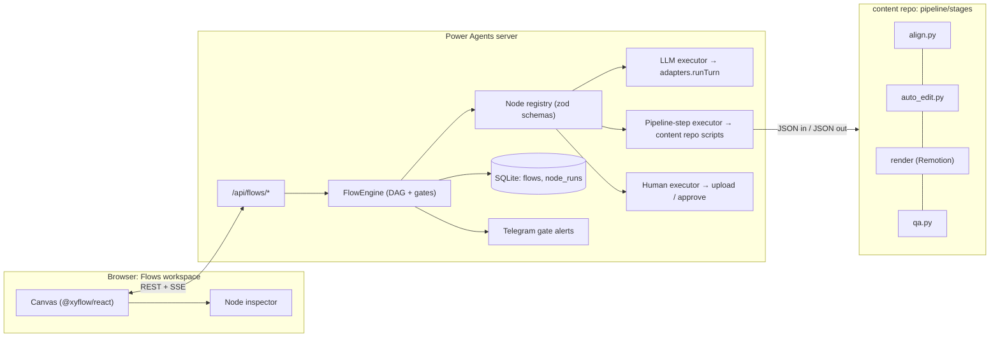
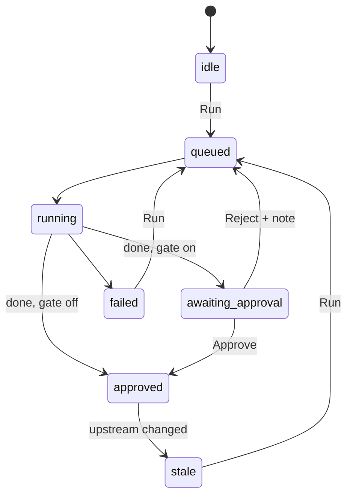

# Plan: Reel Flow workspace in Power Agents

Status: draft for review · 2026-10-30

## Goal

Add a second workspace to Power Agents, **Flows**, next to the existing team runs. A flow is a visual graph of nodes and connectors on a dark canvas, like the reference screenshot. Each node does one step, shows its output inline (text, audio, image, video) and can be run, approved or rejected. The first template is the **Explained in ROBLOX reel**: Idea → Script → Voice-over → Scenes → Capture → Edit → Preview → QA → Final.

Approval drives the flow. A gated node stops in `awaiting approval`. Its downstream nodes stay locked until you approve. Rejecting with a note re-runs that node with the note added. Changing an approved node marks everything downstream as stale.

The reel-editor ideas carry over directly: brand file, `edit.json` card schema, preview-before-final, a hash that marks previews stale, and QA on real frames.

## What exists today (and is reused)

| Existing piece | Location | Reuse in Flows |
| --- | --- | --- |
| Provider adapters (Claude, Codex, Gemini, APIs, demo) | `src/server/adapters/` | LLM nodes call `runTurn` unchanged |
| SQLite store, JSON rows + events | `src/server/store.ts` | New `flows` + `node_runs` tables, same pattern |
| SSE event stream | `/api/events` in `src/server/http.ts` | Push node status changes to the canvas |
| Per-run workspace folders, file listing | `src/server/files.ts` | One folder per flow, one per node output |
| Telegram outbox + approvals | `src/server/telegram.ts` | Gate alerts with Approve / Reject buttons |
| Hash routing | `src/client/navigation.ts` | New routes `#/flows`, `#/flows/<id>` |
| Demo mode | `src/server/core/demo.ts` | Demo executors per node type for tests |

The team-run `Engine` is **not** reused for flows. Flows are a DAG of typed steps with gates. Team runs are a negotiated plan between agents. A small, separate `FlowEngine` keeps both simple.

## Architecture



## Data model (`src/shared/flow-types.ts`)

```ts
type PortType = 'text' | 'idea' | 'script' | 'audio' | 'timings' | 'scenes' | 'video' | 'edit' | 'report' | 'brand';
type NodeStatus = 'idle' | 'queued' | 'running' | 'awaiting_approval' | 'approved' | 'rejected' | 'stale' | 'failed';

interface FlowNode {
  id: string; type: string;             // registry key, e.g. 'script'
  position: { x: number; y: number };
  config: Record<string, unknown>;      // validated by the type's zod schema
  gate: boolean;                        // stop for approval after a run
  status: NodeStatus;
  inputHash?: string;                   // hash of upstream outputs + config at last run
  output?: { port: PortType; value?: unknown; files?: string[] };
  notes?: string[];                     // rejection notes, fed into the next run
  version: number;
}
interface FlowEdge { id: string; from: { node: string; port: string }; to: { node: string; port: string } }
interface Flow { id: string; title: string; template?: string; nodes: FlowNode[]; edges: FlowEdge[];
                 brand?: string; createdAt: string; updatedAt: string; version: number }
```

- `flows` table: `id, created_at, data` (JSON), same as `runs`.
- `node_runs` table: one row per execution (`flow_id, node_id, version, input_hash, status, output, started_at, finished_at, error`). It holds the history, and lets you roll a node back to an earlier output.
- Files: `.power-agents/flows/<flowId>/<nodeId>/v<version>/…`.

## Execution rules (`src/server/flows/engine.ts`)

1. A node is **ready** when every input port is connected to an upstream node that is `approved`. A node without a gate becomes `approved` as soon as its run finishes.
2. **Run** on a ready node queues it. Up to 3 nodes run at once, matching today's limit. Renders run one at a time, at low priority.
3. After the run, a gated node moves to `awaiting_approval`. The server sends a Telegram alert, and nothing downstream starts.
4. **Approve** → `approved`. Downstream nodes run automatically if **Auto-run** is on for the flow; otherwise they wait for a click.
5. **Reject + note** → the node re-runs with the note added to its prompt or config, and gets `version + 1`.
6. **Stale propagation:** when a node's output or config changes, each downstream node compares its stored `inputHash` with the new one. Changed nodes become `stale`. Their old output stays visible but greyed, as the reel-editor preview hash does.
7. **Restart safety:** a node left `running` when the server stopped becomes `failed` with "interrupted, run again". It never re-runs silently, the same rule as team runs (criterion 8).



## Node types (registry: `src/server/flows/nodes/*.ts`)

Each node type declares its input and output ports, a zod config schema, an executor kind and a demo executor.

| Node | Executor | In → Out | Gate | Source of logic |
| --- | --- | --- | --- | --- |
| Brand | static | — → brand | no | `brand.json` + Rules (reel-editor idea) |
| Idea generation | LLM | brand → idea | yes | brief §1–2: backlog, 5-criterion score, keep ≥18 |
| Script | LLM | idea, brand → script | yes | brief §3: metaphor map, 5-beat script, 130–160 words |
| Voice-over | pipeline step (ElevenLabs) or upload | script → audio, timings | yes | forced alignment from script text, -14 LUFS |
| Scenes | LLM | script, timings → scenes | yes | scene JSON for the director (memory: next step) |
| Capture | pipeline step (Studio) or upload | scenes → video | yes | `process_take.py` + magenta sync |
| Edit plan | pipeline step + LLM | timings, video, brand → edit | yes | reel-editor `auto_edit.py`, then LLM accents and cards |
| Preview render | pipeline step | edit, video, audio → video | yes | Remotion, 540p/1080p |
| QA | pipeline step | video, edit → report | auto | reel-editor `qa.py` + hook/length checks, frame grabs |
| Final render | pipeline step | edit, video, audio → video | yes | Remotion full quality, deliver |
| Prompt / Note | static | — → text | no | free text, like the screenshot's Prompt cards |

**Pipeline-step contract** (lives in the content repo, `pipeline/stages/<name>.py`):

```
python3 -I pipeline/stages/<name>.py --in input.json --out output.json --dir <node folder>
input.json  = { "inputs": { port: value | file path }, "config": {...}, "brand": {...}, "notes": [...] }
output.json = { "port": "<type>", "value": ..., "files": ["relative/path.mp4"], "log": "..." }
exit 0 = ok · exit 2 = needs human (message in log) · other = failed
```

The content repo stays the owner of media logic and can be tested on its own. Power Agents only knows the contract. The stage scripts are ported from claude-reel-editor (MIT, with attribution).

## UI (`src/client/flows/`)

- **Library:** `@xyflow/react` 12 (React Flow). It provides pan and zoom, a dotted background, a minimap, custom nodes, typed handles and bezier edges. Install it pinned.
- **Layout:** a left sidebar gets a new entry **Flows**. Routes are `#/flows` (list plus New from template) and `#/flows/<id>` (canvas).
- **Node card** (matches the screenshot): a header with a type icon, the title and the model or tool name. The body shows a preview by output type: a text excerpt, an audio player with waveform, an `<video>` player, or an image. The footer holds Run, Approve and Reject buttons and a status chip. Input ports sit on the left and output ports on the right, coloured by port type.
- **Status styling:** the card border shows state: running pulses, awaiting approval is amber, approved green, stale dimmed, failed red.
- **Inspector:** a drawer on the right for the selected node. It holds the config form generated from the zod schema, the full output, the version history, and a box for rejection notes.
- **Edges:** dragging a connector checks port types; a mismatch is refused with a tooltip.
- **Media:** `GET /api/flows/:id/files/*` serves files with HTTP Range support, so video can be scrubbed. The path is checked with `resolveFile`.
- **Live updates:** the existing SSE stream gets `flow.node` events, and the canvas patches only the node that changed.

## API (`src/server/http.ts` → `src/server/flows/http.ts`)

| Method + path | Purpose |
| --- | --- |
| `GET /api/flows` | list |
| `POST /api/flows` | create (empty, or `{ template: 'roblox-reel' }`) |
| `GET /api/flows/:id` | flow + recent node runs |
| `PATCH /api/flows/:id` | layout, nodes, edges, config (with `version` check) |
| `POST /api/flows/:id/nodes/:nodeId/run` | queue a run |
| `POST /api/flows/:id/nodes/:nodeId/approve` · `/reject` | gate decisions (reject carries a note) |
| `POST /api/flows/:id/nodes/:nodeId/upload` | human input (own VO, a Studio take) |
| `GET /api/flows/:id/files/*` | media with Range support |

All mutating routes reuse the existing CSRF token and loopback-only checks.

## Milestones

Each milestone ends with a check you can see.

### F1 — Headless flow engine
- `flow-types.ts`, store tables, `FlowEngine` with ready, gate, stale and restart rules, registry with demo executors.
- Tests: `tests/flow-engine.test.ts` (gate blocks downstream, reject re-runs with the note, stale propagation, restart leaves a node `failed` and does not re-run it).
- **Done when** a demo flow of 4 nodes runs end to end through the API with two approvals. `npm test` and `npm run typecheck` pass.

### F2 — Canvas workspace
- Flows sidebar entry, routes, React Flow canvas, node cards, inspector, typed connectors, SSE updates, Roblox reel template.
- Playwright: create flow from template → run Idea (demo) → approve → Script starts.
- **Done when** the demo template runs fully from the canvas with no model calls.

### F3 — Real LLM nodes
- Idea, Script and Scenes call `runTurn` with the chosen connection and model. Prompts come from the brief and include the brand Rules and rejection notes.
- **Done when** a live Claude Code run produces an approved idea and script for one topic.

### F4 — Media pipeline stages (content repo)
- `pipeline/stages/`: `voice.py` (ElevenLabs + alignment), `capture.py` (wrap `process_take.py`), `edit_plan.py` (port `auto_edit.py`), `render.py` (Remotion props from `edit.json`), `qa.py` (port + hook/length checks), with Python tests.
- `Reel.tsx` renders from `edit.json` + `brand.json`. This is step 1 of the Reel Editor Adaptation Plan.
- Pipeline-step executor in Power Agents, plus Range-served media in node cards.
- **Done when** reel 002 goes from approved script to a final MP4 inside one flow. Capture may be a manual upload.

### F5 — Approve from Telegram
- Gate alerts get inline Approve and Reject buttons (Telegram `callback_query`), plus a reply-to-reject note. The alert includes a 540p preview for video nodes.
- **Done when** a reel's preview is approved from a phone and the final render starts.

### F6 — Automation (later)
- Auto-run mode, topic backlog scheduling, Roblox Studio MCP capture without manual upload, and publishing nodes.

## Risks

| Risk | Mitigation |
| --- | --- |
| Long renders block other work | render queue of 1, `nice -n 15`, preview at 540p |
| Large media in SQLite | files on disk only; DB stores paths |
| ElevenLabs free plan bans commercial use | paid plan before publishing; upload-your-own-VO node as fallback |
| Studio cannot save by MCP (Cmd+S needed) | Capture node returns exit 2 "needs human" with the instruction |
| YouTube "inauthentic content" for templated videos | template fixes styling only; Idea/Script nodes must vary beats; QA flags repeated card sequences |
| Two engines drift apart | share adapters, store helpers, Telegram outbox; keep FlowEngine under ~400 lines |

## Open questions

1. Should Auto-run be on by default, so an approval starts the next node right away? Or should every node wait for a click?
2. Voice: will you use your own recorded voice (upload node) or ElevenLabs as the default?
3. Should flows show up in the existing run history, or only in the Flows list?
